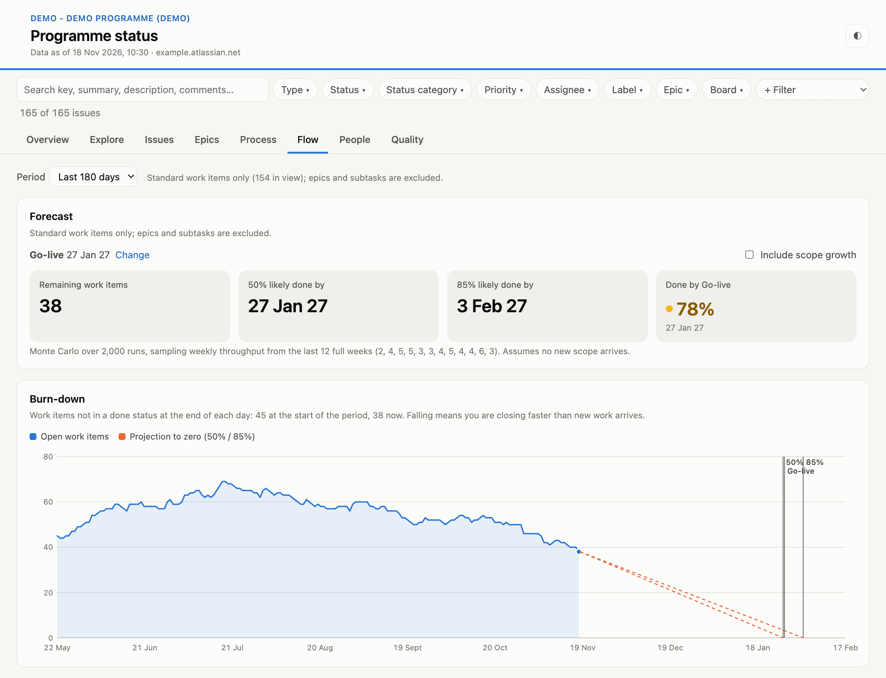
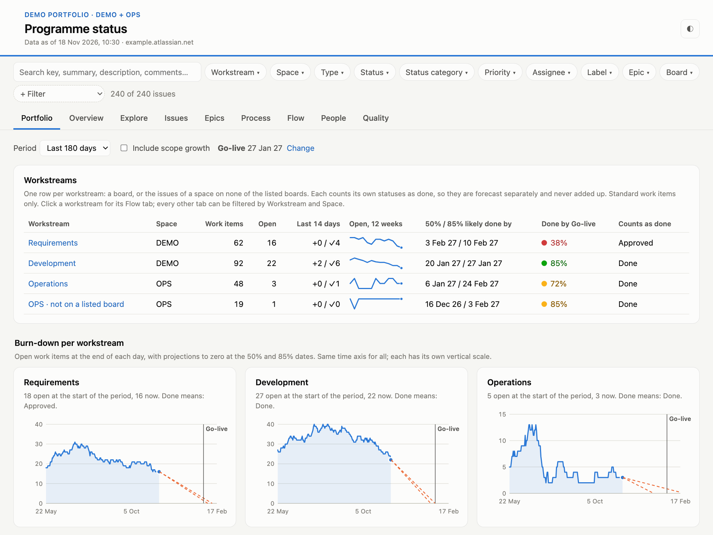

# jira-report

One command turns a Jira Cloud project into a **single, self-contained, branded HTML report**:
status and classification sliced any way you like, process health, flow (burn-up, burn-down, cumulative
flow, throughput, cycle time) and a probabilistic forecast against a target date you can change
in the page. The file works offline, has no external requests, and opens anywhere.

```sh
jira-report https://example.atlassian.net/jira/software/c/projects/DEMO/boards/202
```

Read-only against Jira. Node 20+, no dependencies.





*Both screenshots come from `jira-report example`: made-up data in the neutral brand.*

## Requirements

- **Node 20 or newer.** There is nothing to `npm install`: the tool has no dependencies.
- **A Jira Cloud site** and an account that can browse the projects you report on (see
  [What the Jira account needs](#what-the-jira-account-needs)). Jira Server / Data Center is not
  supported.
- **macOS** (developed and tested there). Linux and Windows should work but are untested. On
  macOS credentials go into the Keychain. Elsewhere they go into a file only you can read (see
  [Signing in](#signing-in)). `tools/install.sh` needs a bash shell.
- For development only: **Google Chrome or Chromium** for the browser smoke test.

## Install

```sh
git clone <this repository> jira-report
cd jira-report
tools/install.sh          # links ~/bin/jira-report -> bin/jira-report.mjs
```

`tools/install.sh DIR` links into `DIR` instead. The script tells you when that folder is not
on your `PATH` or when Node is too old. You can also skip it and run `node bin/jira-report.mjs`.

## Quick start

```sh
jira-report example        # an example report from made-up data: no Jira, no sign-in
jira-report https://<site>.atlassian.net/jira/software/c/projects/<KEY>/boards/<id>
```

The first command shows what the report looks like. The second asks you to sign in (an API
token, see [Signing in](#signing-in)), fetches the project and opens the report in your browser.
Copy the URL from your browser's address bar while looking at the board or project.

## Use

```sh
jira-report <board-or-project-url>            # fetch, render, open in the browser
jira-report <url> --no-open -o /tmp/x.html    # render somewhere else, don't open
jira-report <url> --brand default             # the neutral built-in brand
jira-report <url> --target "Go-live=2027-01-15"
jira-report <url> --refresh                   # ignore the cache, fetch everything again
jira-report <url> --quality                   # add the Quality tab (see below)
jira-report <url> --no-history                # don't save this run's summary (see History)
jira-report example                           # an example report from made-up data (no Jira needed)
jira-report example --portfolio               # the same for a portfolio (two spaces, four workstreams)
jira-report --help
```

`jira-report example` writes `reports/example/example.html` and opens it. It uses fictional
people and issues, a made-up history of earlier runs, and a target ten weeks out (`--target`
sets another), so every tab and trend card has something to show. It needs no credentials and
always uses the neutral brand, whatever your config says: made-up data under a real
organisation's brand would pass for that organisation's report. Use it to try the report, show
it to someone, or check a change to the template.

The URL can be a board URL, a project URL or an issue's `/browse/KEY-1` URL. **The report
always covers the whole project**, plus every issue that any of the project's boards shows (board
filters can reach into other projects). Each issue is tagged with its boards, and the **Board**
filter in the page slices by it. Filter to exactly one board and the cumulative-flow chart uses
that board's columns.

The first run fetches every issue with its full change history. Later runs list the scope's keys
and `updated` stamps and re-fetch only what changed. The cache is
`~/.cache/jira-report/<site>/<PROJECT>.json`, outside the repo and mode 0600.

Each report gets its own folder: `reports/<site>-<PROJECT>/<site>-<PROJECT>.html`, with the
reviewer notes and the run history (below) next to it.

## Portfolio: several boards and spaces in one report

```sh
jira-report https://example.atlassian.net/jira/software/c/projects/DEMO/boards/202 \
            https://example.atlassian.net/jira/software/c/projects/DEMO/boards/201 \
            https://example.atlassian.net/jira/software/c/projects/OPS/boards/900 \
            --name demo-ops --save        # first run: name it, keep it in your local config
jira-report demo-ops                      # every run after that
```

A portfolio report is built from **workstreams**. Each board URL is one workstream, with that
board's issues. A space URL without a board is one workstream with the whole space. The issues of
a space that are on none of the listed boards become one more workstream per space
(`OPS · not on a listed board`), so nothing in scope goes uncounted. All URLs must be on one Jira
site. Each space is fetched once and shares its cache with that space's single report.

Workstreams are kept apart because **"done" differs between them**. A requirements board may count
*Approved* as done, while a development board counts *Done*. Adding those together would mix two
kinds of progress, so each workstream gets its own forecast, and the report never shows a
combined one.

- **Portfolio tab** (opens first): a table with one row per workstream. Each row shows work
  items, open items, the last 14 days in and out, a 12-week sparkline of open work, the 50%/85%
  forecast and its chance against the target, and which statuses count as done. Below the table
  are a burn-down per workstream on one shared time axis, the links and parent/child relations
  that cross workstreams (and references to spaces outside the portfolio), and the people with
  open work in more than one workstream.
- **Every other tab** gives the detail, sliced by the **Workstream** and **Space** filters.
  Clicking a workstream opens its Flow tab. Overview and Flow show a notice when the view spans
  several workstreams.
- `--save` writes the portfolio to `jira-report.local.json` (or to the config file in use),
  under `portfolios.<name>`. You can edit its `title` and the workstream `name`s there. That file
  is gitignored, which matters because portfolio names and URLs identify the organisation.
- The output goes to `reports/<site>-<name>/`, and the history keeps a forecast per workstream
  from the first run.

## Signing in

Credentials are resolved in this order:

1. `$JIRA_EMAIL` + `$JIRA_API_TOKEN` (CI, one-off runs)
2. a stored **OAuth session** (browser sign-in), refreshed silently
3. a stored **API token**
4. otherwise, when run in a terminal, an **interactive sign-in**: OAuth in the browser if an
   OAuth app is configured, else the guided API-token flow

Stored credentials live in the macOS Keychain (service `jira-report`), or elsewhere in
`~/.config/jira-report/credentials.json` (0600). `jira-report logout <site>` removes them.

### Guided API token (works right away)

```sh
jira-report login example.atlassian.net --token
```

This opens Atlassian's API-token page. Create a token, paste it with your account email, and it
is verified against Jira and stored.

### Browser sign-in (OAuth 2.0, one-time app registration)

Atlassian only offers a real "log in in the browser" flow through an OAuth app. Register one once:

1. Go to <https://developer.atlassian.com/console/myapps/> → **Create** → **OAuth 2.0 integration**.
2. **Permissions** → Jira API → add the read scopes `read:jira-work` and `read:jira-user`. For
   board columns and filters also add the Jira Software scopes `read:board-scope:jira-software`
   and `read:board-scope.admin:jira-software`, plus `read:project:jira` and
   `read:issue-details:jira`.
3. **Authorization** → callback URL `http://localhost:8765/callback`. The port is
   `oauth.callbackPort` in the config.
4. **Settings** → copy the Client ID and Secret, then run:

```sh
jira-report oauth-setup                  # stores client ID + secret in the Keychain
jira-report login example.atlassian.net  # opens the browser; approve; done
```

From then on `jira-report <url>` signs in silently. It opens the browser again only when the
session can no longer be refreshed. The requested scopes are `oauth.scopes` in the config. If the
site's admins restrict third-party apps, use the API-token route. If the board scopes are
missing, the report still renders, only without board filters and columns.

### What the Jira account needs

The report sees what the signed-in account sees, nothing more. It only reads.

- **Browse projects** permission on every project in scope. Issues the account can't see are
  missing from the report, without a warning.
- **Access to the boards** for board filters and columns. Without it the report still renders,
  only without the Board filter, and cumulative flow shows status categories instead of
  board columns.
- With OAuth, the scopes listed above. The `offline_access` scope lets the session refresh
  without a new browser sign-in.

### Troubleshooting

| symptom | cause and fix |
|---------|---------------|
| `no credentials for <site>` | Not run in a terminal and nothing stored. Set `JIRA_EMAIL` + `JIRA_API_TOKEN`, or run `jira-report login <site>` once. |
| `token rejected by <site> (401)` | Wrong email or token, or a token from another Atlassian account. Create a new one and log in again. |
| `this login has no access to <site>` | OAuth: the app was approved for another site. The message lists the sites it can see. |
| `no OAuth app configured` | Run `jira-report oauth-setup` first, or use `jira-report login <site> --token`. |
| `! cannot read boards (403)` | The account or the OAuth scopes don't cover boards. The report renders without board filters. |
| `board <id> is not located in a project` | The board belongs to a user, not a project. Use the project URL instead. |
| Report counts look low | The account can't browse some issues, or a board filter excludes them. Compare with a JQL search in Jira as the same user. |
| Old data after a change in Jira | Run with `--refresh` to ignore the cache. |
| Example shows the neutral brand | That is on purpose. `jira-report example` never uses a real brand. |

Rate limits (429) and server errors (5xx) are retried automatically, honouring `Retry-After`.

## Configuration

`defaults/jira-report.config.json` is the annotated reference. To override it, put a
`jira-report.config.json` in or above the directory you run from, put a `jira-report.local.json`
in this repo's root (gitignored), or pass `--config`. Only the keys you change are needed, and
relative paths resolve against the config file.

| key | meaning |
|-----|---------|
| `portfolios` | `{ "<name>": { "title": "…", "streams": [{ "name": "…", "url": "…" }] } }`, written by `--save`; keep it in a local config |
| `brand` | brand folder (default `brands/default`; put your own brands in `brands/`, which is gitignored); `--brand <name\|dir>` per run |
| `title` | report heading (default "Programme status") |
| `outputDir` | where reports land (default `reports/`, gitignored) |
| `milestones` | `[{ "name": "UAT", "date": "2027-01-15" }]`; the first is the default target |
| `customFieldMinFill` | custom fields filled on at least this share of issues become dimensions (default 0.05; in a portfolio, the share within any one space) |
| `forecast.weeks` / `forecast.runs` | throughput sample window (full weeks) / Monte Carlo runs |
| `oauth.clientId` / `oauth.callbackPort` / `oauth.scopes` | OAuth app settings (the secret is never in config) |
| `quality` / `qualityNotes` | always add the Quality tab / path of its reviewer notes (Markdown) |
| `concurrency` | parallel requests for the per-issue fallbacks |

**Target date.** The report opens with the first milestone (UAT, 15 Jan 2027). **Change** next to
it, on the Overview and Flow tabs, sets another name and date. The browser remembers it per
project, and **Reset to config** restores the default.

### Brands

A brand is a folder with `brand.json` and a logo:

```json
{ "name": "Acme", "logo": "logo.svg", "accent": "#3D5A80", "accentLight": "#4F73A3", "accentDark": "#9DB8DA" }
```

`accent` colours the chrome: header rule, active tab, active filters. `accentLight` is the
link/text shade and `accentDark` is the accent in dark mode. In dark mode the logo is recoloured
to off-white. Data colours come from a fixed, colour-blind-validated palette and are not themed.

## What's in the report

A sticky **filter bar** (search plus dimension filters) applies to every tab. Filters are kept in
the URL hash, so a filtered view can be bookmarked. Search covers key, summary, description,
comments, labels and assignee. Every count and bar can be clicked to list its issues, and every
issue opens a drawer with fields, links, children, description, comments, attachments and the
full change history.

| tab | shows |
|-----|-------|
| **Portfolio** | (portfolio reports only) the workstreams side by side: open work, recent flow, forecast, what counts as done, a burn-down each, cross-workstream dependencies and shared people |
| **Overview** | counts per status category, created/completed in the last 14 days, median cycle time, the forecast against the target, the status mix, open work by type and priority, the longest-waiting in-progress issues, and recent status changes |
| **Explore** | a pivot of any dimension against any other (type, status, category, priority, assignee, reporter, label, component, fix version, epic, board, resolution, created or completed month, open-age bucket, and custom fields), counting all or only open issues |
| **Issues** | a sortable issue table |
| **Epics** | per-epic progress (to do / in progress / done) with the children; subtasks roll up through their parent |
| **Process** | aging work in progress against cycle-time percentiles, time in each status, a status-transition matrix (backward moves show rework), reopened issues, stale open issues |
| **Flow** | burn-down (open work over time) and burn-up (scope vs. done) with the target and the 50%/85% projections, cumulative flow, created vs. completed per week on one scale (with the net change in open work), a cycle-time scatter, and the forecast (optionally with scope growth) |
| **Quality** | (with `--quality`) content checks per issue type, weakest open issues, unlinked copies, reviewer notes |
| **People** | open work, recent and total throughput, longest-waiting item, and issues reported, per person |

### Quality tab (`--quality`)

This tab checks whether each issue has the parts a reader needs. It doesn't grade the writing,
and every check is listed on the tab.
- **Bugs:** expected vs. actual behaviour, where it was seen, evidence in text rather than only a
  screenshot, and steps to reproduce.
- **Features and stories:** acceptance criteria or pre-/post-conditions, testable "should/must"
  outcomes, one change per issue, and whether it is a request rather than a question or a
  disguised defect.
- **All issues:** a description of 15+ words, placement under an epic, and no unlinked
  near-copy of another issue.

Each issue gets a score (the share of applicable checks it passes) and a grade: Good ≥ 80%, Fair
50–79%, Poor < 50%. **Quality** and **Quality gap** also become filter dimensions. The checks run
in the page on every build, and no issue text leaves your machine.

**Reviewer notes** are optional Markdown shown at the top of the tab, e.g. a one-off human or
assistant review. Pass them with `--quality-notes <file.md>`, or place them beside the report as
`<report>.quality-notes.md` (for example `reports/example-DEMO/example-DEMO.quality-notes.md`), and they
are picked up automatically. Issue keys in the notes become links, and the notes are dated by the
file's modification time. They contain client content, so keep them in the gitignored `reports/`.

**Opening in Teams / SharePoint.** Their preview renders the file in a sandbox. The report works
there, but the filters can't be saved to the page address, so a filtered view can't be
bookmarked in that preview.

**Definitions**
- *Done* means the status category is Done. An issue that is reopened stops counting as done.
- *Completed at* is the last time it entered a done status.
- *Cycle time* runs from the first move into an in-progress status until completion. *Lead time*
  runs from creation.
- The flow metrics (burn-up, burn-down, cumulative flow, throughput, cycle time, forecast) count
  **standard work items only**. Epics are containers, and subtasks would be counted twice.
- The *forecast* is a Monte Carlo simulation that samples weekly throughput from the last N full
  weeks. It shows when the remaining items are 50% / 85% likely to be done, and how likely they
  are to be done by the target. Unless "Include scope growth" is ticked, it assumes no new scope.

## History

The flow charts need no stored history. Burn-up, burn-down, cumulative flow, throughput, cycle time and the
forecast are rebuilt from Jira's change log on every run, for the whole life of the project.

Three things can't be rebuilt that way, so every run saves a small summary in `history/` next to
the report (`<YYYY-MM-DD>_<HHMMSS>.json`, 0600):

- **Quality over time** (Quality tab). The scores are computed on today's text, so the summary
  keeps each run's scores, overall and per reporter. Quality is scored on every run, also without
  `--quality`, so the trend has no gaps. A fingerprint of the check rules is saved too: when the
  rules change, the table marks that runs before and after aren't comparable.
- **Forecast track record** (Flow tab). Each saved forecast is set against what happened since to
  the work items open at that moment: all done by the 50% or 85% date, or how many are still
  open. Saved forecasts use the report's default view: whole project, no scope growth, the
  configured target. A portfolio saves one forecast per workstream, plus each issue's workstreams
  (board membership is not in Jira's change log). Filter to one workstream to see its record.
- **Left the scope** (Flow tab). Issues seen in an earlier run that have since been moved out or
  deleted. The charts no longer count them, so past throughput shrinks silently. This card shows
  by how much.

Issues are matched by id, so an issue that only changed key is not counted as lost. When there
are several runs on one day, the last one counts. The trend cards cover the whole scope and
ignore the page filters. They appear from the second run. Files from another site or project in
the same folder are skipped. The summaries hold issue keys, summaries and reporter names, so
treat them as confidential, like the report.

## Confidentiality

The report embeds **full issue data**: names, email addresses, descriptions and comments.
Output files are written 0600 into the gitignored `reports/`. The tool publishes nothing and
never writes to Jira.

## Development

```sh
npm test            # node:test: analytics, model, ADF, URL parsing, portfolio, rendering (offline)
npm run fixture     # render the example data at a fixed date into reports/:
                    #   fixture.html            one space, with a made-up history and the Quality tab
                    #   fixture-first-run.html  no history, no Quality tab
                    #   fixture-portfolio.html  two spaces, four workstreams
npm run smoke       # all three fixtures, then a headless-Chrome check of every tab and interaction
```

The smoke test looks for Chrome in the usual places. Set `$CHROME` to point it elsewhere.

**Layout.**

- `bin/jira-report.mjs`: the command line.
- `lib/`:
  - `config`: config discovery and URL parsing.
  - `auth`, `secrets`: env, Keychain, OAuth and token sign-in.
  - `http`, `jira`: retrying fetch and the REST client.
  - `collect`: scope and the incremental cache.
  - `portfolio`: workstreams (resolve, merge spaces, save).
  - `model`: raw Jira responses into the compact model.
  - `render`: template assembly.
  - `history`: per-run summaries and trends. It evaluates `app/analytics.js` and `app/quality.js`
    in Node, so stored numbers match the report.
  - `example`: example models from the synthetic data in `lib/example/`, used by `jira-report
    example` and the fixtures.
- `template/`: `report.html` plus `styles/` and `app/`. These are plain scripts sharing one scope,
  inlined into the output. `app/analytics.js` is pure and unit-tested.

**Branches.** Work happens on `feature/<topic>` branches, merged with `--no-ff` into
`development/dev`. `development/uat` and `master` follow by fast-forward when a set of changes
is accepted.

**No client data in the repository, ever.** Reports are made for real organisations, and the
repository must not identify any of them, history included. That rules out:

- site names, space keys and board ids;
- programme or portfolio names;
- logos and brand colours;
- milestone dates, and issue text copied into tests.

Tests and examples use `example.atlassian.net`, the made-up `DEMO`/`OPS` spaces and boards 201,
202 and 900, and the fictional Acme brand in `test/fixtures/brand`. Real brands go in the
gitignored `brands/<name>`, and engagement settings in the gitignored `jira-report.local.json`.
Check the staged diff before every commit.

## License

MIT, see [LICENSE](LICENSE).
